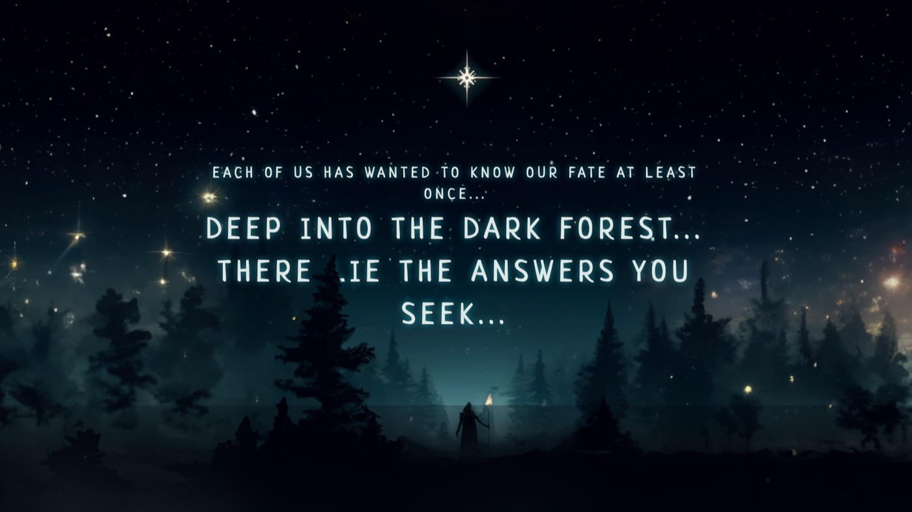

# Fortune Teller

**A mystical Magic-8-Ball experience with parallax scrolling, GSAP animations and AI-generated artwork.**



**[Ask the ball →](https://anastacodes.github.io/FortuneTeller/)**

## Features

- Ask a question, shake the ball, receive your fortune
- Smooth parallax scrolling powered by GSAP ScrollTrigger
- Atmospheric visuals generated with AI image tools
- Custom typography and a fully hand-crafted landing page
- Vanilla HTML, CSS and JavaScript — the interactive logic fits in ~50 lines

## Run locally

```bash
git clone https://github.com/AnastaCodes/FortuneTeller.git
open FortuneTeller/index.html
```

## Acknowledgments

- Inspired by the classic Magic 8 Ball toy.
- Animations by [GSAP](https://gsap.com/) (GreenSock Animation Platform).
